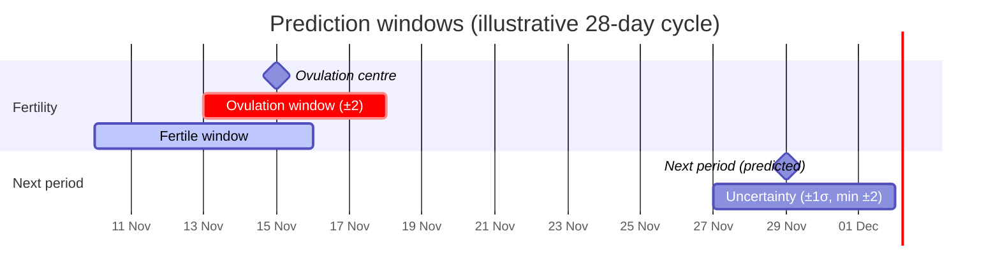

# BDR-0004: Prediction is a window, not a date

## Context

The product is health-adjacent. A single predicted date reads as a certainty
even when the user's cycles are irregular, and the current implementation
hard-codes `prediction_confidence: 0.5`, which communicates nothing about how
much the prediction can be trusted.

The product must be honest about uncertainty without becoming useless for
automations: a bare date is easy to automate against, but a range is only
useful if its shape and meaning are fixed.

## Decision

We will promise the next period date together with an uncertainty window, an
ovulation window, and a fertile window — never a bare date alone.

The rules that make up that promise:

- **Uncertainty window:** ±1 standard deviation of the cycle lengths used, with
  a lower bound of ±2 days. When there is no deviation, it collapses to the
  predicted date.
- **Ovulation window:** centered on the predicted next period minus 14 days,
  ±2 days.
- **Fertile window:** five days before ovulation through ovulation day, six days
  total and asymmetric.
- **Phase boundaries:** derived from the ovulation window — menstrual while
  within the period length, ovulatory around the ovulation window, follicular
  before it, luteal after it.
- **History:** the last 6 completed cycles. A cycle is start-to-start.
- **Minimum history:** 2 completed cycles. Before that the prediction sensor is
  `unknown`; there is no fallback to the configured cycle length.
- **Outliers:** cycles outside the 15–90 day range are excluded from prediction
  only. They stay in history and statistics and produce a warning. The bounds
  are fixed by default, with an advanced override.
- **Data gaps:** a gap longer than 90 days is missing data, not a cycle.
- **Algorithms:** arithmetic mean, weighted moving average (the default), and
  median, user-selectable.
- **Confidence:** `min(1, 1 − σ/mean) × min(1, n/6)`, exposed as an attribute of
  the statistics sensor with bands low < 0.4, medium 0.4–0.7, high > 0.7.
- **Late period:** when the predicted date passes without a new period, the
  sensor marks it late. The predicted date does not move on its own.
- **Wording:** must not read as a contraceptive guarantee. The exact copy is
  deferred to the card work.

The windows sit on the cycle as follows (illustrative 28-day cycle):

Ovulation centre sits 14 days before the predicted next period; the fertile
window runs the five days before ovulation through ovulation day; the
uncertainty window is ±1 standard deviation of the cycle lengths used, floored
at ±2 days. Dates are illustrative; real values come from the user's history.

In scope: what the product promises to show and how each window is derived.
Out of scope: the implementation structure, the exact card copy, and any
all-history statistic beyond the prediction window.

## Alternatives considered

| Alternative | Why not |
|---|---|
| A single date | Presents false certainty on irregular cycles and hides that the prediction is an estimate. |
| A single date plus a range, but no fertile window | Keeps ovulation and fertility implicit, so the product cannot answer the question users actually ask. |
| Ovulation as half the cycle length | Has no physiological basis and contradicts the 14-days-before-next-period model. |
| A symmetric fertile window (ovulation ±2 days) | The fertile window is not symmetric around ovulation; five days before through ovulation day is the intended shape. |
| Predicting immediately from the configured cycle length | Produces a confident-looking prediction with no user data behind it; `unknown` is more honest. |
| Keeping the constant confidence | A fixed 0.5 says nothing and cannot improve as history grows. |
| Moving the predicted date forward each day | Hides a late period instead of reporting it, and makes automations drift silently. |

## Expected impact

- **Users:** a more honest product. Users who expect a single date need the
  range explained, and the card becomes more complex.
- **Revenue / cost:** no direct revenue impact. The cost is additional sensor
  attributes and card work; estimates are unknown.
- **Operations / support:** more values to document and explain, especially the
  uncertainty window, the confidence bands, and the outlier warning.
- **Risk / compliance:** the fertile window must not be worded as
  contraception. Confidence now means something and must stay explainable, or
  it becomes another opaque number.

## Evidence

- `docs/ideas/prediction-algorithms.md` — records the answers this decision
  formalizes: prediction output, ovulation basis, fertile window, uncertainty
  window, minimum history, algorithm set, outliers, data gaps, confidence, and
  late periods.
- Current behavior: `prediction.py` implements only arithmetic mean and
  weighted moving average; the coordinator falls back to the configured cycle
  length below 2 cycles; `prediction_confidence` is the constant `0.5`.
- `docs/adr/0005-solid-and-clean-architecture.md` — prediction strategies and
  the `Clock` port constrain how these rules are implemented.

Assumption: the 15–90 day outlier bounds and the 90-day gap threshold are
acceptable defaults for the target users. No usage data or user counts are
available to validate them.

## Follow-up

- [ ] Implement the prediction outputs and rules in the domain model.
- [ ] Add the confidence value and band to the statistics sensor attributes.
- [ ] Define the card copy for the range, the fertile window, and the late
      state, ensuring it does not read as a contraceptive guarantee.
- [ ] Add the advanced outlier-bound override to the options flow.
- [ ] Revisit this record if user feedback shows the windows are too wide to
      automate against or too narrow to be honest.
