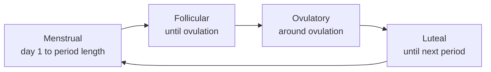
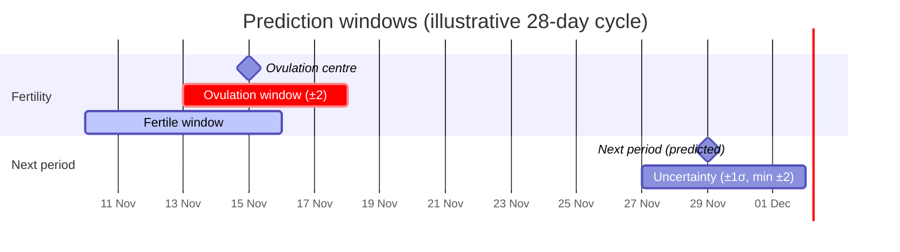
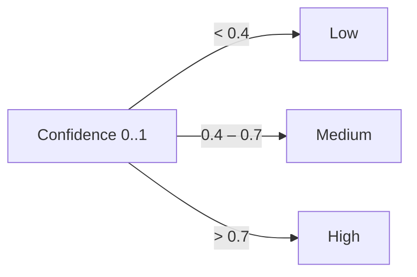

# How Cycle Tracker predicts your cycle

This guide explains how Cycle Tracker turns the periods you log into a
prediction. It is for anyone who wants to understand what the sensors mean,
whether the prediction can be trusted, and how to use the result in an
automation.

Cycle Tracker is a local, health-adjacent helper. The values it shows are
estimates derived from your own recorded history — they are not medical advice
and must not be used as a contraceptive guarantee.

## The four phases

Cycle Tracker divides each cycle into four phases, in this order:



- **Menstrual** — the period itself, from cycle day 1 for as long as your
  configured `period_length`.
- **Follicular** — after the period, before ovulation.
- **Ovulatory** — the few days around ovulation.
- **Luteal** — after ovulation, until the next period starts.

## Where a prediction comes from

A cycle length is the number of days between two consecutive period start
dates. Prediction is only as good as the history behind it:

- **Minimum history:** two completed cycles. Before that, the prediction sensor
  is `unknown` — the configured cycle length is not used as a fake prediction.
- **History window:** the most recent six completed cycles feed the prediction.
- **Algorithms:** you choose one of three —
  - **Arithmetic mean** — averages the cycle lengths equally.
  - **Weighted moving average** — weights newer cycles more heavily (the
    default).
  - **Median** — the middle value, most resistant to outliers.
- **Outliers:** cycles outside 15–90 days are excluded from prediction only.
  They stay in your history and statistics and produce a warning, so you can
  fix a typo or accept a genuinely long cycle.
- **Data gaps:** a gap longer than 90 days is treated as missing data, not a
  cycle, and is excluded the same way.

The full derivation, from recorded periods to the values on the sensors:

```mermaid
flowchart LR
    H[Last 6 completed cycles] --> A[Chosen algorithm<br/>mean / weighted moving average / median]
    A --> P[Predicted cycle length]
    P --> D[Next period date]
    D --> U[Uncertainty window<br/>±1 sigma, min ±2 days]
    P --> O[Ovulation = next period − 14 days]
    O --> OW[Ovulation window ±2 days]
    O --> F[Fertile window<br/>5 days before ovulation .. ovulation]
    H --> S[Sigma and mean]
    S --> C[Confidence = min(1, 1−σ/mean) × min(1, n/6)]
    C --> B[Band: low / medium / high]
```

## The prediction is a window, not a date

A single predicted date would read as more certain than it is. Cycle Tracker
shows a date together with the windows around it:

- **Uncertainty window** — the predicted next period ±1 standard deviation of
  the cycle lengths used, with a lower bound of ±2 days. When there is no
  deviation, the window collapses to the predicted date.
- **Ovulation window** — centered on the predicted next period minus 14 days,
  ±2 days.
- **Fertile window** — the five days before ovulation through ovulation day
  (six days total).

The windows sit on the cycle like this (illustrative 28-day cycle):



## What "confidence" means

Confidence is a number from 0 to 1 that answers "how much should this
prediction be trusted":

```
confidence = min(1, 1 − σ/mean) × min(1, n/6)
```

where σ is the standard deviation of the cycles used, `mean` is their average,
and `n` is how many cycles there are. It rises as your cycles become more
regular and as you log more of them, and is exposed as an attribute of the
statistics sensor together with a verbal band:



## What happens when a period is late

When the predicted date passes without a new period being logged, the sensor
marks the period as **late**. The predicted date does not move on its own, so
your automations do not drift silently — you decide what to do.

## Using the prediction in an automation

The `days_until_period` sensor is the most actionable value. Example: notify
the day before a predicted period:

```yaml
automation:
  - trigger:
      - trigger: numeric_state
        entity_id: sensor.cycle_tracker_days_until_period
        above: 0
        below: 1
    action:
      - action: persistent_notification.create
        data:
          title: Cycle Tracker
          message: >-
            Period expected around
            {{ states('sensor.cycle_tracker_next_period_date') }}.
```

Sensors return `unknown` until at least two completed cycles have been logged,
so guard automations accordingly.
